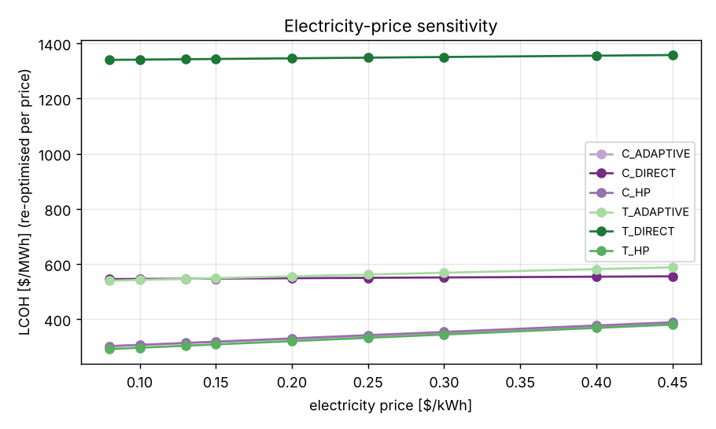

# Case A - Western PA greenhouse: thermosiphon vs coaxial TEA

_Hypothetical existing ~5,700 ft gas well near a 10,000 ft2 greenhouse. Resource anchored to the Penn State (2025) case study; no well log, completion diagram or quote is held._
Model version 0.1.0, config hash `129cfe54fb05`, 71 designs searched, runtime 147.5 s. All numbers are computed by the code from the inputs listed in `provenance.csv`; most inputs are **assumed** (see that file).

## Economic optimum per architecture (customer dispatch, FEASIBLE designs only)

| architecture | design | status | geo_capability_kW_y1 | geo_capability_kW_y20 | E_useful_MWh_total | SPF_system | unmet_share | lcoh | site_cost_per_MWh | incumbent_only_cost_per_MWh | npv |
|---|---|---|---|---|---|---|---|---|---|---|---|
| C_ADAPTIVE | C_ADAPTIVE VIT114mm m=1.5kg/s T_in=22C | FEASIBLE | 118.3 | 97.5 | 12008.2 | 4.5 | 0.0 | 313.3 | 313.3 | 47.9 | -1381044.5 |
| C_DIRECT | C_DIRECT VIT89mm m=5.0kg/s T_in=var | FEASIBLE | 40.2 | 27.3 | 5223.3 | 35.9 | 0.6 | 546.9 | 274.8 | 47.9 | -1171281.1 |
| C_HP | C_HP VIT114mm m=1.5kg/s T_in=20C | FEASIBLE | 127.3 | 107.0 | 12008.2 | 4.3 | 0.0 | 314.1 | 314.1 | 47.9 | -1385216.6 |
| T_ADAPTIVE | T_ADAPTIVE ammonia T_top=42C ins=843m film | FEASIBLE | 40.8 | 28.0 | 5890.1 | 7.6 | 0.5 | 546.4 | 302.0 | 47.9 | -1311274.6 |
| T_DIRECT | T_DIRECT ammonia T_top=50C ins=1047m film | FEASIBLE | 17.8 | 11.1 | 2178.4 | 20.0 | 0.8 | 1342.5 | 297.2 | 47.9 | -1279006.4 |
| T_HP | T_HP ammonia T_top=25C ins=0m guided | FEASIBLE | 109.2 | 84.4 | 11871.6 | 4.2 | 0.0 | 303.9 | 302.0 | 47.9 | -1323391.1 |

`lcoh` = geothermal-only levelised cost of useful heat [$/MWh]; `site_cost_per_MWh` blends in backup heat for unmet load; `incumbent_only_cost_per_MWh` is the customer's cost with no geothermal.

## Resource test: maximum year-20 capability per architecture (sink never limiting)

| architecture | design | status | geo_capability_kW_t0 | geo_capability_kW_y1 | geo_capability_kW_y10 | geo_capability_kW_y20 | E_geo_MWh_total | y20_over_y3_capability | sustainable_80pct |
|---|---|---|---|---|---|---|---|---|---|
| C_ADAPTIVE | C_ADAPTIVE VIT114mm m=3.0kg/s T_in=12C | FEASIBLE | 208.0 | 168.3 | 129.9 | 123.7 | 23314.1 | 0.9 | True |
| C_DIRECT | C_DIRECT VIT89mm m=5.0kg/s T_in=var | FEASIBLE | 52.0 | 39.8 | 29.0 | 27.3 | 5231.1 | 0.8 | True |
| C_HP | C_HP VIT114mm m=5.0kg/s T_in=5C | FEASIBLE | 269.3 | 214.7 | 163.4 | 155.3 | 29367.8 | 0.9 | True |
| T_ADAPTIVE | T_ADAPTIVE ammonia T_top=42C ins=843m guided | FEASIBLE | 52.0 | 40.6 | 29.9 | 28.3 | 5394.9 | 0.8 | True |
| T_DIRECT | T_DIRECT ammonia T_top=50C ins=1047m guided | FEASIBLE | 24.5 | 18.1 | 12.3 | 11.4 | 2231.2 | 0.8 | False |
| T_HP | T_HP ammonia T_top=10C ins=0m guided | FEASIBLE | 220.4 | 175.8 | 133.9 | 127.3 | 24056.1 | 0.9 | True |

## Thermosiphon working-fluid screening (resource mode)

| fluid | architecture | best_geo_kW_y20 | statuses |
|---|---|---|---|
| ammonia | T_ADAPTIVE | 28.3 | FEASIBLE |
| ammonia | T_DIRECT | 11.4 | FEASIBLE |
| ammonia | T_HP | 119.7 | FEASIBLE,UNVALIDATED |
| co2 | T_ADAPTIVE | 0.0 | INFEASIBLE |
| co2 | T_DIRECT | 0.0 | INFEASIBLE |
| co2 | T_HP | 91.0 | INFEASIBLE,UNVALIDATED |
| isobutane | T_ADAPTIVE | 8.5 | FEASIBLE,UNVALIDATED |
| isobutane | T_DIRECT | 0.0 | FEASIBLE |
| isobutane | T_HP | 95.6 | FEASIBLE,UNVALIDATED |
| pentane | T_ADAPTIVE | 10.3 | FEASIBLE,UNVALIDATED |
| pentane | T_DIRECT | 0.0 | FEASIBLE |
| pentane | T_HP | 73.6 | UNVALIDATED |
| propane | T_ADAPTIVE | 8.9 | FEASIBLE,UNVALIDATED |
| propane | T_DIRECT | 0.0 | FEASIBLE |
| propane | T_HP | 100.9 | FEASIBLE,UNVALIDATED |
| water | T_ADAPTIVE | 15.4 | FEASIBLE,UNVALIDATED |
| water | T_DIRECT | 8.6 | FEASIBLE,UNVALIDATED |
| water | T_HP | 53.6 | UNVALIDATED |

## Thermosiphon vs coaxial

* Base-case LCOH ratio (best thermosiphon / best coaxial, FEASIBLE designs): **0.97**
* Monte Carlo over cost/finance inputs (36 ranged parameters): P(thermosiphon cheaper) = **0.45** (incl. UNVALIDATED designs: 0.61); ratio P10/P50/P90 = 0.88 / 1.02 / 1.16

### Largest drivers of the TS/C cost ratio (tornado)

| parameter | low | base | high | ratio_low | ratio_high |
|---|---|---|---|---|---|
| vit_per_m | 120 | 250 | 500 | 1.17 | 0.732 |
| ts_capex_mult | 0.85 | 1 | 1.5 | 0.926 | 1.12 |
| coax_capex_mult | 0.85 | 1 | 1.25 | 1.03 | 0.889 |
| ts_leak_allowance_per_yr | 0 | 5e+03 | 2e+04 | 0.943 | 1.05 |
| ts_internals_per_m | 0 | 15 | 60 | 0.951 | 1.03 |
| guide_line_per_m | 15 | 35 | 70 | 0.944 | 1.02 |
| ts_string_per_m_base | 25 | 40 | 80 | 0.951 | 1.02 |
| ts_safety_ammonia | 2e+04 | 4e+04 | 1e+05 | 0.955 | 1.02 |
| steel_per_kg | 1.8 | 2.5 | 4 | 0.954 | 1 |
| ts_om_per_yr | 3e+03 | 6e+03 | 1.2e+04 | 0.954 | 1 |

### Electricity-price sweep (LCOH, $/MWh)

| electricity_price | C_ADAPTIVE | C_DIRECT | C_HP | T_ADAPTIVE | T_DIRECT | T_HP |
|---|---|---|---|---|---|---|
| $0.08/kWh | 302 | 546 | 302 | 540 | 1340 | 292 |
| $0.10/kWh | 307 | 546 | 307 | 542 | 1341 | 297 |
| $0.13/kWh | 313 | 547 | 314 | 546 | 1342 | 304 |
| $0.15/kWh | 318 | 547 | 319 | 549 | 1343 | 309 |
| $0.20/kWh | 329 | 549 | 331 | 556 | 1346 | 321 |
| $0.25/kWh | 340 | 550 | 342 | 562 | 1348 | 333 |
| $0.30/kWh | 351 | 552 | 354 | 569 | 1351 | 345 |
| $0.40/kWh | 373 | 554 | 377 | 582 | 1355 | 369 |
| $0.45/kWh | 384 | 556 | 389 | 588 | 1358 | 380 |

## Figures

See `../../MODEL_LIMITATIONS.md` before using any number here.
