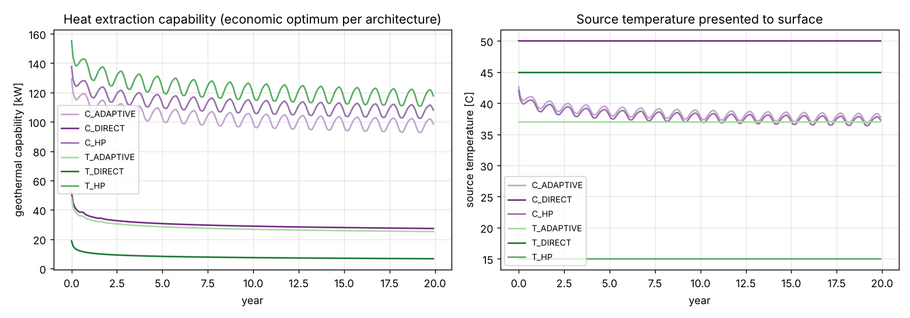
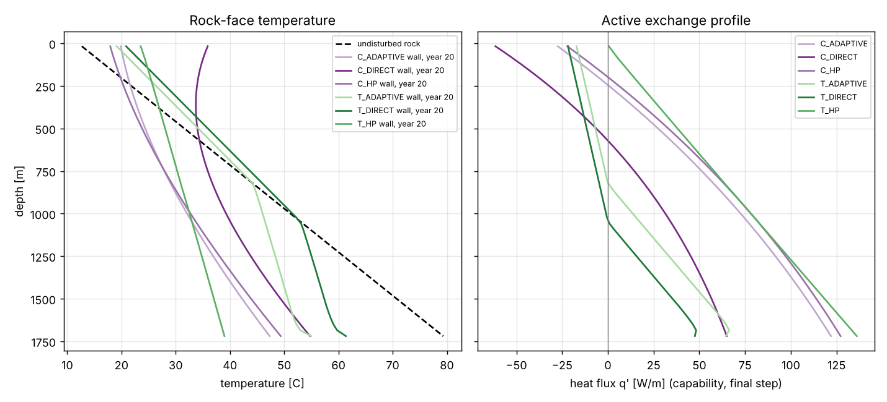
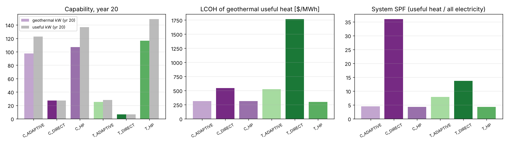
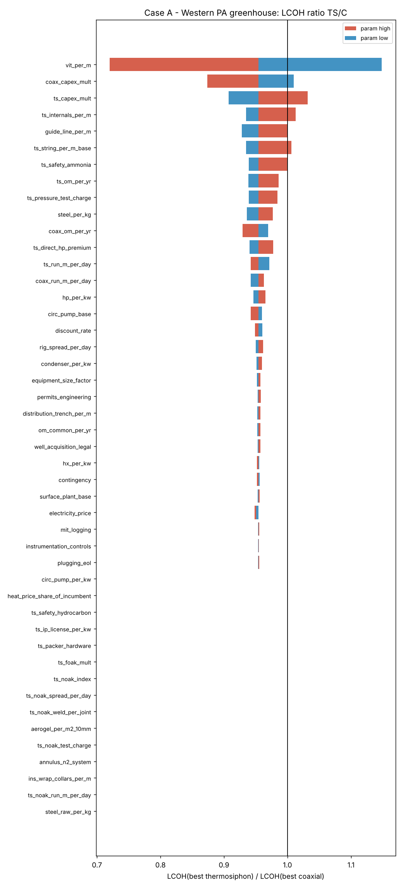

# Case A - Western PA greenhouse: thermosiphon vs coaxial TEA

_Hypothetical existing ~5,700 ft gas well near a 10,000 ft2 greenhouse. Resource anchored to the Penn State (2025) case study; no well log, completion diagram or quote is held._
Model version 0.1.0, config hash `4542c438cc1f`, 71 designs searched, runtime 131.1 s. All numbers are computed by the code from the inputs listed in `provenance.csv`; most inputs are **assumed** (see that file).

## Economic optimum per architecture (customer dispatch, FEASIBLE designs only)

| architecture | design | status | geo_capability_kW_y1 | geo_capability_kW_y20 | E_useful_MWh_total | SPF_system | unmet_share | lcoh | site_cost_per_MWh | incumbent_only_cost_per_MWh | npv |
|---|---|---|---|---|---|---|---|---|---|---|---|
| C_ADAPTIVE | C_ADAPTIVE VIT114mm m=1.5kg/s T_in=22C | FEASIBLE | 118.3 | 97.5 | 12008.2 | 4.5 | 0.0 | 313.3 | 313.3 | 47.9 | -1381044.5 |
| C_DIRECT | C_DIRECT VIT89mm m=5.0kg/s T_in=var | FEASIBLE | 40.2 | 27.3 | 5223.3 | 35.9 | 0.6 | 546.9 | 274.8 | 47.9 | -1171281.1 |
| C_HP | C_HP VIT114mm m=1.5kg/s T_in=20C | FEASIBLE | 127.3 | 107.0 | 12008.2 | 4.3 | 0.0 | 314.1 | 314.1 | 47.9 | -1385216.6 |
| T_ADAPTIVE | T_ADAPTIVE ammonia T_top=42C ins=843m film | FEASIBLE | 37.5 | 25.3 | 5374.7 | 7.9 | 0.6 | 526.9 | 272.1 | 47.9 | -1157699.8 |
| T_DIRECT | T_DIRECT ammonia T_top=50C ins=1047m film | FEASIBLE | 12.8 | 6.7 | 1386.4 | 13.7 | 0.9 | 1765.6 | 263.6 | 47.9 | -1105813.1 |
| T_HP | T_HP ammonia T_top=20C ins=0m guided | FEASIBLE | 142.0 | 116.4 | 12008.2 | 4.3 | 0.0 | 298.9 | 298.9 | 47.9 | -1307703.6 |

`lcoh` = geothermal-only levelised cost of useful heat [$/MWh]; `site_cost_per_MWh` blends in backup heat for unmet load; `incumbent_only_cost_per_MWh` is the customer's cost with no geothermal.

## Resource test: maximum year-20 capability per architecture (sink never limiting)

| architecture | design | status | geo_capability_kW_t0 | geo_capability_kW_y1 | geo_capability_kW_y10 | geo_capability_kW_y20 | E_geo_MWh_total | y20_over_y3_capability | sustainable_80pct |
|---|---|---|---|---|---|---|---|---|---|
| C_ADAPTIVE | C_ADAPTIVE VIT114mm m=3.0kg/s T_in=12C | FEASIBLE | 208.0 | 168.3 | 129.9 | 123.7 | 23314.1 | 0.9 | True |
| C_DIRECT | C_DIRECT VIT89mm m=5.0kg/s T_in=var | FEASIBLE | 52.0 | 39.8 | 29.0 | 27.3 | 5231.1 | 0.8 | True |
| C_HP | C_HP VIT114mm m=5.0kg/s T_in=5C | FEASIBLE | 269.3 | 214.7 | 163.4 | 155.3 | 29367.8 | 0.9 | True |
| T_ADAPTIVE | T_ADAPTIVE ammonia T_top=42C ins=843m guided | FEASIBLE | 48.7 | 37.5 | 27.1 | 25.5 | 4903.6 | 0.8 | True |
| T_DIRECT | T_DIRECT ammonia T_top=50C ins=1047m guided | FEASIBLE | 19.2 | 13.2 | 7.8 | 7.0 | 1438.4 | 0.7 | False |
| T_HP | T_HP ammonia T_top=10C ins=0m guided | FEASIBLE | 220.4 | 175.8 | 133.9 | 127.3 | 24056.1 | 0.9 | True |

## Thermosiphon working-fluid screening (resource mode)

| fluid | architecture | best_geo_kW_y20 | statuses |
|---|---|---|---|
| ammonia | T_ADAPTIVE | 25.5 | FEASIBLE |
| ammonia | T_DIRECT | 7.0 | FEASIBLE |
| ammonia | T_HP | 119.7 | FEASIBLE,UNVALIDATED |
| co2 | T_ADAPTIVE | 0.0 | INFEASIBLE |
| co2 | T_DIRECT | 0.0 | INFEASIBLE |
| co2 | T_HP | 91.0 | INFEASIBLE,UNVALIDATED |
| isobutane | T_ADAPTIVE | 5.2 | FEASIBLE,UNVALIDATED |
| isobutane | T_DIRECT | 0.0 | FEASIBLE |
| isobutane | T_HP | 95.6 | FEASIBLE,UNVALIDATED |
| pentane | T_ADAPTIVE | 7.4 | FEASIBLE,UNVALIDATED |
| pentane | T_DIRECT | 0.0 | FEASIBLE |
| pentane | T_HP | 73.6 | UNVALIDATED |
| propane | T_ADAPTIVE | 5.6 | FEASIBLE,UNVALIDATED |
| propane | T_DIRECT | 0.0 | FEASIBLE |
| propane | T_HP | 100.9 | FEASIBLE,UNVALIDATED |
| water | T_ADAPTIVE | 15.4 | FEASIBLE,UNVALIDATED |
| water | T_DIRECT | 5.9 | FEASIBLE |
| water | T_HP | 53.6 | UNVALIDATED |

## Thermosiphon vs coaxial

* Base-case LCOH ratio (best thermosiphon / best coaxial, FEASIBLE designs): **0.95**
* Monte Carlo over cost/finance inputs (46 ranged parameters): P(thermosiphon cheaper) = **0.63** (incl. UNVALIDATED designs: 0.79); ratio P10/P50/P90 = 0.84 / 0.97 / 1.09

### Largest drivers of the TS/C cost ratio (tornado)

| parameter | low | base | high | ratio_low | ratio_high |
|---|---|---|---|---|---|
| vit_per_m | 120 | 250 | 500 | 1.15 | 0.72 |
| coax_capex_mult | 0.85 | 1 | 1.25 | 1.01 | 0.874 |
| ts_capex_mult | 0.85 | 1 | 1.25 | 0.908 | 1.03 |
| ts_internals_per_m | 0 | 15 | 60 | 0.935 | 1.01 |
| guide_line_per_m | 15 | 35 | 70 | 0.928 | 1 |
| ts_string_per_m_base | 25 | 40 | 80 | 0.935 | 1.01 |
| ts_safety_ammonia | 2e+04 | 4e+04 | 1e+05 | 0.939 | 0.999 |
| ts_om_per_yr | 3e+03 | 6e+03 | 1.2e+04 | 0.938 | 0.986 |
| ts_pressure_test_charge | 2e+04 | 4e+04 | 8e+04 | 0.939 | 0.984 |
| steel_per_kg | 2.2 | 3 | 4 | 0.936 | 0.977 |

### Electricity-price sweep (LCOH, $/MWh)

| electricity_price | C_ADAPTIVE | C_DIRECT | C_HP | T_ADAPTIVE | T_DIRECT | T_HP |
|---|---|---|---|---|---|---|
| $0.08/kWh | 302 | 546 | 302 | 521 | 1762 | 287 |
| $0.10/kWh | 307 | 546 | 307 | 523 | 1764 | 292 |
| $0.13/kWh | 313 | 547 | 314 | 527 | 1766 | 299 |
| $0.15/kWh | 318 | 547 | 319 | 529 | 1767 | 303 |
| $0.20/kWh | 329 | 549 | 331 | 536 | 1770 | 314 |
| $0.25/kWh | 340 | 550 | 342 | 542 | 1774 | 324 |
| $0.30/kWh | 351 | 552 | 354 | 548 | 1777 | 334 |
| $0.40/kWh | 373 | 554 | 377 | 561 | 1784 | 354 |
| $0.45/kWh | 384 | 556 | 389 | 567 | 1787 | 364 |

## Figures

See `../../MODEL_LIMITATIONS.md` before using any number here.

## What would need to be true (guided-return validity Ku <= 3.2)
Thermosiphon at FOAK / today's base / NOAK and with cumulative scale levers (thermosiphon only); coaxial and the incumbent stay at today's assumptions. Best FEASIBLE design re-picked at each step.

**Coverage: any** (coaxial today $313/MWh; incumbent $48/MWh)
| thermosiphon case | ts_lcoh | ts_over_coax | carbon_price_for_parity | ts_unmet_max | ts_design |
|---|---|---|---|---|---|
| FOAK (1.5x base) | 347.67 | 1.11 | 1407.84 | 0.00 | T_HP ammonia T_top=20C ins=0m guided |
| today's base costs | 298.92 | 0.95 | 1178.92 | 0.00 | T_HP ammonia T_top=20C ins=0m guided |
| 1. NOAK manufacturing + automated install (raw x 2.5) | 256.22 | 0.82 | 978.36 | 0.04 | T_HP ammonia T_top=25C ins=0m guided |
| 2. standardised well-reuse programme (common -40%, contingency 10%) | 213.86 | 0.68 | 779.45 | 0.04 | T_HP ammonia T_top=25C ins=0m guided |
| 3. heat pump $500/kW | 199.17 | 0.64 | 710.47 | 0.04 | T_HP ammonia T_top=25C ins=0m guided |
| 4. infrastructure financing 6% real | 167.41 | 0.53 | 561.33 | 0.04 | T_HP ammonia T_top=25C ins=0m guided |

**Coverage: full (<2% unmet every year)** (coaxial today $313/MWh; incumbent $48/MWh)
| thermosiphon case | ts_lcoh | ts_over_coax | carbon_price_for_parity | ts_unmet_max | ts_design |
|---|---|---|---|---|---|
| FOAK (1.5x base) | 347.67 | 1.11 | 1407.84 | 0.00 | T_HP ammonia T_top=20C ins=0m guided |
| today's base costs | 298.92 | 0.95 | 1178.92 | 0.00 | T_HP ammonia T_top=20C ins=0m guided |
| 1. NOAK manufacturing + automated install (raw x 2.5) | 256.54 | 0.82 | 979.90 | 0.00 | T_HP ammonia T_top=20C ins=0m guided |
| 2. standardised well-reuse programme (common -40%, contingency 10%) | 214.86 | 0.69 | 784.14 | 0.00 | T_HP ammonia T_top=20C ins=0m guided |
| 3. heat pump $500/kW | 200.40 | 0.64 | 716.26 | 0.00 | T_HP ammonia T_top=20C ins=0m guided |
| 4. infrastructure financing 6% real | 168.79 | 0.54 | 567.81 | 0.00 | T_HP ammonia T_top=20C ins=0m guided |

**Break-evens** (nan = no parity inside the search range)

* `noak_index_for_coax_parity_any` = 6.29
* `noak_index_for_incumbent_parity_any` = n/a
* `vit_price_for_parity_ts_base_any` = 214.81
* `vit_price_for_parity_ts_noak_any` = 110.08
* `noak_index_for_coax_parity_full` = 6.29
* `noak_index_for_incumbent_parity_full` = n/a
* `vit_price_for_parity_ts_base_full` = 214.81
* `vit_price_for_parity_ts_noak_full` = 110.88
