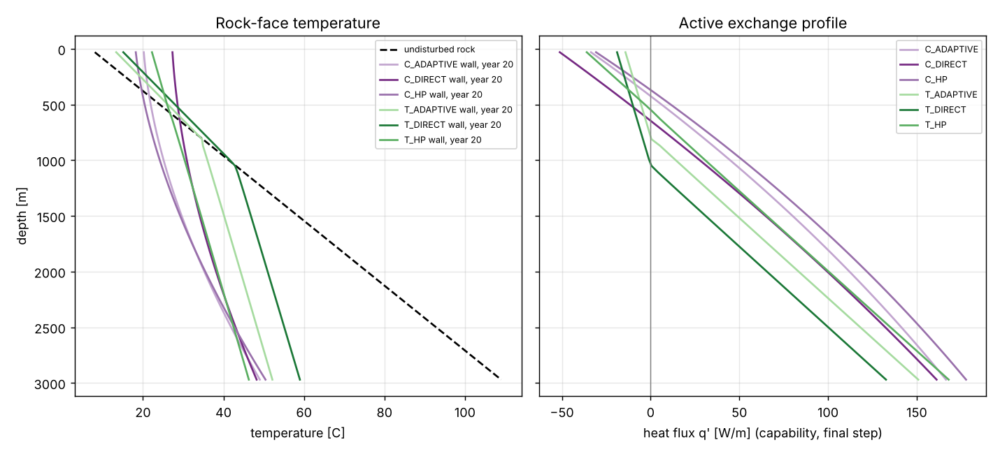
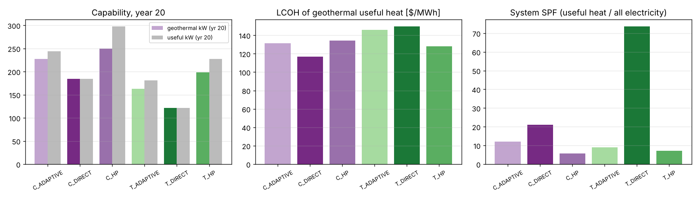
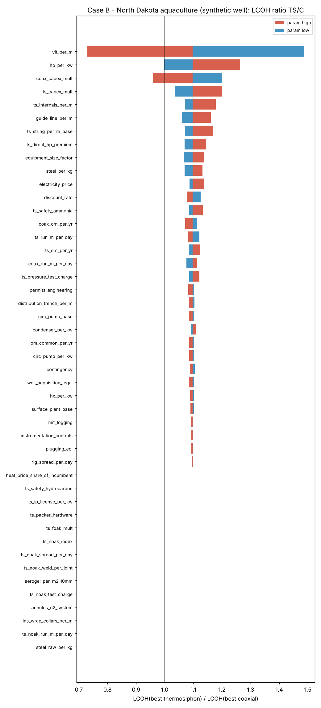

# Case B - North Dakota aquaculture (synthetic well): thermosiphon vs coaxial TEA

_Synthetic 3,000 m well, 110 C BHT, near a recirculating-aquaculture heat customer. Mandaree open-loop doublet results are NOT transferable to a single closed-loop well._
Model version 0.1.0, config hash `74a431e7b5f8`, 73 designs searched, runtime 456.1 s. All numbers are computed by the code from the inputs listed in `provenance.csv`; most inputs are **assumed** (see that file).

## Economic optimum per architecture (customer dispatch, FEASIBLE designs only)

| architecture | design | status | geo_capability_kW_y1 | geo_capability_kW_y20 | E_useful_MWh_total | SPF_system | unmet_share | lcoh | site_cost_per_MWh | incumbent_only_cost_per_MWh | npv |
|---|---|---|---|---|---|---|---|---|---|---|---|
| C_ADAPTIVE | C_ADAPTIVE VIT114mm m=3.0kg/s T_in=22C | FEASIBLE | 308.8 | 227.1 | 40401.9 | 12.0 | 0.0 | 131.5 | 129.9 | 76.2 | -1092915.8 |
| C_DIRECT | C_DIRECT VIT114mm m=8.0kg/s T_in=var | FEASIBLE | 273.3 | 184.5 | 34743.7 | 21.1 | 0.2 | 116.8 | 110.9 | 76.2 | -736387.4 |
| C_HP | C_HP VIT114mm m=3.0kg/s T_in=20C | FEASIBLE | 330.5 | 250.0 | 42018.3 | 5.7 | 0.0 | 134.3 | 134.3 | 76.2 | -1175616.5 |
| T_ADAPTIVE | T_ADAPTIVE ammonia T_top=32C ins=816m guided | FEASIBLE | 231.3 | 162.8 | 34019.5 | 8.9 | 0.2 | 146.0 | 134.6 | 76.2 | -1158639.7 |
| T_DIRECT | T_DIRECT ammonia T_top=40C ins=1049m guided | FEASIBLE | 170.9 | 121.3 | 23048.0 | 73.6 | 0.5 | 149.5 | 118.2 | 76.2 | -828454.5 |
| T_HP | T_HP ammonia T_top=25C ins=0m guided | FEASIBLE | 283.7 | 198.2 | 39413.6 | 7.2 | 0.1 | 128.1 | 125.7 | 76.2 | -1014960.4 |

`lcoh` = geothermal-only levelised cost of useful heat [$/MWh]; `site_cost_per_MWh` blends in backup heat for unmet load; `incumbent_only_cost_per_MWh` is the customer's cost with no geothermal.

## Resource test: maximum year-20 capability per architecture (sink never limiting)

| architecture | design | status | geo_capability_kW_t0 | geo_capability_kW_y1 | geo_capability_kW_y10 | geo_capability_kW_y20 | E_geo_MWh_total | y20_over_y3_capability | sustainable_80pct |
|---|---|---|---|---|---|---|---|---|---|
| C_ADAPTIVE | C_ADAPTIVE VIT89mm m=3.0kg/s T_in=12C | FEASIBLE | 436.8 | 361.9 | 285.6 | 273.0 | 51142.0 | 0.9 | True |
| C_DIRECT | C_DIRECT VIT114mm m=8.0kg/s T_in=var | FEASIBLE | 340.6 | 263.4 | 194.7 | 184.3 | 35100.1 | 0.8 | True |
| C_HP | C_HP VIT114mm m=5.0kg/s T_in=5C | FEASIBLE | 562.1 | 455.6 | 351.9 | 335.3 | 63155.8 | 0.9 | True |
| T_ADAPTIVE | T_ADAPTIVE ammonia T_top=32C ins=816m guided | FEASIBLE | 285.5 | 226.7 | 171.4 | 162.7 | 30827.9 | 0.9 | True |
| T_DIRECT | T_DIRECT ammonia T_top=40C ins=1049m guided | FEASIBLE | 217.0 | 170.9 | 128.0 | 121.3 | 23048.0 | 0.9 | True |
| T_HP | T_HP ammonia T_top=25C ins=0m guided | FEASIBLE | 334.6 | 267.1 | 203.5 | 193.5 | 36574.0 | 0.9 | True |

## Thermosiphon working-fluid screening (resource mode)

| fluid | architecture | best_geo_kW_y20 | statuses |
|---|---|---|---|
| ammonia | T_ADAPTIVE | 162.7 | FEASIBLE,UNVALIDATED |
| ammonia | T_DIRECT | 121.3 | FEASIBLE,UNVALIDATED |
| ammonia | T_HP | 278.3 | FEASIBLE,UNVALIDATED |
| co2 | T_ADAPTIVE | 0.0 | INFEASIBLE |
| co2 | T_DIRECT | 0.0 | INFEASIBLE |
| co2 | T_HP | 0.0 | INFEASIBLE,UNVALIDATED |
| isobutane | T_ADAPTIVE | 90.7 | UNVALIDATED |
| isobutane | T_DIRECT | 51.1 | FEASIBLE,UNVALIDATED |
| isobutane | T_HP | 160.6 | UNVALIDATED |
| pentane | T_ADAPTIVE | 69.9 | FEASIBLE,UNVALIDATED |
| pentane | T_DIRECT | 48.0 | FEASIBLE,UNVALIDATED |
| pentane | T_HP | 96.7 | FEASIBLE,UNVALIDATED |
| propane | T_ADAPTIVE | 97.5 | UNVALIDATED |
| propane | T_DIRECT | 52.8 | UNVALIDATED |
| propane | T_HP | 217.4 | UNVALIDATED |
| water | T_ADAPTIVE | 69.3 | UNVALIDATED |
| water | T_DIRECT | 61.1 | UNVALIDATED |
| water | T_HP | 67.7 | UNVALIDATED |

## Thermosiphon vs coaxial

* Base-case LCOH ratio (best thermosiphon / best coaxial, FEASIBLE designs): **1.10**
* Monte Carlo over cost/finance inputs (46 ranged parameters): P(thermosiphon cheaper) = **0.32** (incl. UNVALIDATED designs: 0.54); ratio P10/P50/P90 = 0.87 / 1.09 / 1.32

### Largest drivers of the TS/C cost ratio (tornado)

| parameter | low | base | high | ratio_low | ratio_high |
|---|---|---|---|---|---|
| vit_per_m | 120 | 250 | 500 | 1.49 | 0.73 |
| hp_per_kw | 500 | 800 | 1.3e+03 | 0.998 | 1.26 |
| coax_capex_mult | 0.85 | 1 | 1.25 | 1.2 | 0.959 |
| ts_capex_mult | 0.85 | 1 | 1.25 | 1.04 | 1.2 |
| ts_internals_per_m | 0 | 15 | 60 | 1.07 | 1.18 |
| guide_line_per_m | 15 | 35 | 70 | 1.06 | 1.16 |
| ts_string_per_m_base | 25 | 40 | 80 | 1.07 | 1.17 |
| ts_direct_hp_premium | 0 | 0.15 | 0.4 | 1.07 | 1.14 |
| equipment_size_factor | 1.15 | 1.3 | 1.5 | 1.07 | 1.14 |
| steel_per_kg | 2.2 | 3 | 4 | 1.07 | 1.13 |

### Electricity-price sweep (LCOH, $/MWh)

| electricity_price | C_ADAPTIVE | C_DIRECT | C_HP | T_ADAPTIVE | T_DIRECT | T_HP |
|---|---|---|---|---|---|---|
| $0.08/kWh | 132 | 117 | 135 | 147 | 150 | 129 |
| $0.10/kWh | 133 | 118 | 139 | 149 | 150 | 132 |
| $0.13/kWh | 136 | 120 | 144 | 152 | 150 | 136 |
| $0.15/kWh | 137 | 121 | 147 | 154 | 151 | 139 |
| $0.20/kWh | 142 | 123 | 156 | 160 | 151 | 146 |
| $0.25/kWh | 146 | 126 | 165 | 166 | 152 | 153 |
| $0.30/kWh | 149 | 128 | 174 | 171 | 153 | 160 |
| $0.40/kWh | 154 | 133 | 191 | 182 | 154 | 174 |
| $0.45/kWh | 157 | 136 | 200 | 187 | 155 | 181 |

## B2: prospective (ramped) customer

| architecture | design | status | E_useful_MWh_total | lcoh | npv | site_cost_per_MWh | customer_facility_capex_reported_separately |
|---|---|---|---|---|---|---|---|
| C_ADAPTIVE | C_ADAPTIVE VIT114mm m=3.0kg/s T_in=22C | FEASIBLE | 38936.7 | 141.8 | -1175706.7 | 140.1 | 3000000 |
| C_DIRECT | C_DIRECT VIT114mm m=8.0kg/s T_in=var | FEASIBLE | 33632.7 | 124.7 | -797741.9 | 118.0 | 3000000 |
| C_HP | C_HP VIT114mm m=3.0kg/s T_in=20C | FEASIBLE | 40445.4 | 144.5 | -1252746.5 | 144.5 | 3000000 |
| T_ADAPTIVE | T_ADAPTIVE ammonia T_top=32C ins=816m guided | FEASIBLE | 32933.8 | 147.4 | -1097714.5 | 136.3 | 3000000 |
| T_DIRECT | T_DIRECT ammonia T_top=40C ins=1049m guided | FEASIBLE | 22701.0 | 154.2 | -847007.1 | 123.0 | 3000000 |
| T_HP | T_HP ammonia T_top=25C ins=0m guided | FEASIBLE | 38014.5 | 137.8 | -1090430.2 | 135.0 | 3000000 |

The customer facility capex is **not** in the geothermal LCOH.

## Figures

See `../../MODEL_LIMITATIONS.md` before using any number here.

## What would need to be true (guided-return validity Ku <= 3.2)
Thermosiphon at FOAK / today's base / NOAK and with cumulative scale levers (thermosiphon only); coaxial and the incumbent stay at today's assumptions. Best FEASIBLE design re-picked at each step.

**Coverage: any** (coaxial today $117/MWh; incumbent $76/MWh)
| thermosiphon case | ts_lcoh | ts_over_coax | carbon_price_for_parity | ts_unmet_max | ts_design |
|---|---|---|---|---|---|
| FOAK (1.5x base) | 152.29 | 1.30 | 319.15 | 0.10 | T_HP ammonia T_top=25C ins=0m guided |
| today's base costs | 128.12 | 1.10 | 217.76 | 0.10 | T_HP ammonia T_top=25C ins=0m guided |
| 1. NOAK manufacturing + automated install (raw x 2.5) | 109.32 | 0.94 | 138.88 | 0.10 | T_HP ammonia T_top=25C ins=0m guided |
| 2. standardised well-reuse programme (common -40%, contingency 10%) | 94.16 | 0.81 | 75.28 | 0.10 | T_HP ammonia T_top=25C ins=0m guided |
| 3. heat pump $500/kW | 83.33 | 0.71 | 29.83 | 0.10 | T_HP ammonia T_top=25C ins=0m guided |
| 4. infrastructure financing 6% real | 69.71 | 0.60 | 0.00 | 0.10 | T_HP ammonia T_top=25C ins=0m guided |

**Coverage: full (<2% unmet every year)** (coaxial today $134/MWh; incumbent $76/MWh)
| thermosiphon case | ts_lcoh | ts_over_coax | carbon_price_for_parity | ts_unmet_max | ts_design |
|---|---|---|---|---|---|
| FOAK (1.5x base) | n/a | n/a | 0.00 | n/a | nan |
| today's base costs | n/a | n/a | 0.00 | n/a | nan |
| 1. NOAK manufacturing + automated install (raw x 2.5) | n/a | n/a | 0.00 | n/a | nan |
| 2. standardised well-reuse programme (common -40%, contingency 10%) | n/a | n/a | 0.00 | n/a | nan |
| 3. heat pump $500/kW | n/a | n/a | 0.00 | n/a | nan |
| 4. infrastructure financing 6% real | n/a | n/a | 0.00 | n/a | nan |

**Break-evens** (nan = no parity inside the search range)

* `noak_index_for_coax_parity_any` = 3.43
* `noak_index_for_incumbent_parity_any` = n/a
* `vit_price_for_parity_ts_base_any` = 298.26
* `vit_price_for_parity_ts_noak_any` = 218.41
* `noak_index_for_coax_parity_full` = n/a
* `noak_index_for_incumbent_parity_full` = n/a
* `vit_price_for_parity_ts_base_full` = n/a
* `vit_price_for_parity_ts_noak_full` = n/a
