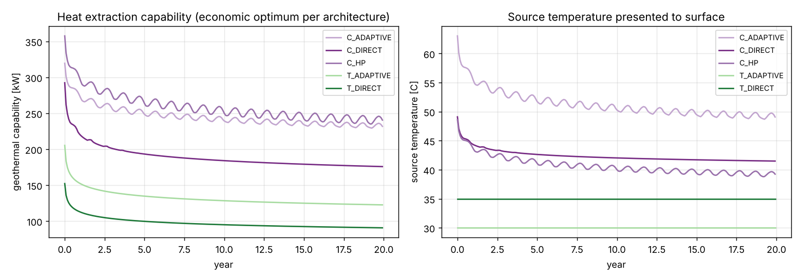
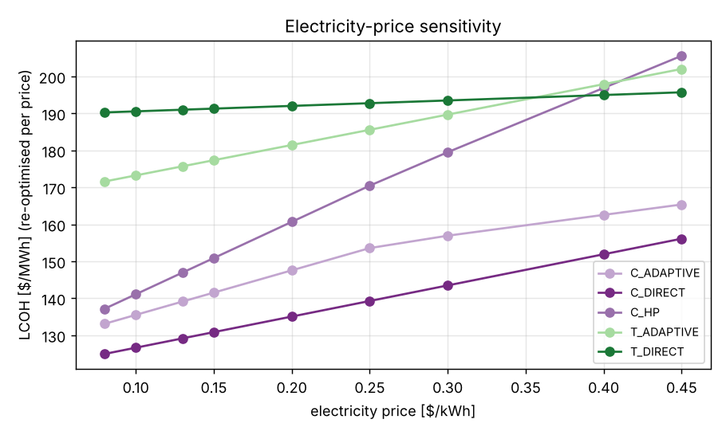

# Case B - North Dakota aquaculture (synthetic well): thermosiphon vs coaxial TEA

_Synthetic 3,000 m well, 110 C BHT, near a recirculating-aquaculture heat customer. Mandaree open-loop doublet results are NOT transferable to a single closed-loop well._
Model version 0.1.0, config hash `d7257ecedfbd`, 57 designs searched, runtime 24.6 s. All numbers are computed by the code from the inputs listed in `provenance.csv`; most inputs are **assumed** (see that file).

## Economic optimum per architecture (customer dispatch, FEASIBLE designs only)

| architecture | design | status | geo_capability_kW_y1 | geo_capability_kW_y20 | E_useful_MWh_total | SPF_system | unmet_share | lcoh | site_cost_per_MWh | incumbent_only_cost_per_MWh | npv |
|---|---|---|---|---|---|---|---|---|---|---|---|
| C_ADAPTIVE | C_ADAPTIVE VIT89mm m=1.5kg/s T_in=12C | FEASIBLE | 288.7 | 232.6 | 41245.9 | 8.1 | 0.0 | 132.5 | 131.8 | 76.2 | -1128090.8 |
| C_DIRECT | C_DIRECT VIT89mm m=5.0kg/s T_in=var | FEASIBLE | 241.0 | 176.2 | 33021.4 | 11.5 | 0.2 | 124.5 | 115.5 | 76.2 | -812855.3 |
| C_HP | C_HP VIT89mm m=3.0kg/s T_in=20C | FEASIBLE | 317.5 | 240.5 | 41947.1 | 5.1 | 0.0 | 136.2 | 136.1 | 76.2 | -1208286.0 |
| T_ADAPTIVE | T_ADAPTIVE ammonia T_top=35C ins=0m guided | FEASIBLE | 166.6 | 122.9 | 24675.0 | 12.1 | 0.4 | 171.2 | 134.1 | 76.2 | -1118787.9 |
| T_DIRECT | T_DIRECT ammonia T_top=40C ins=0m guided | FEASIBLE | 123.4 | 90.9 | 17115.7 | 67.1 | 0.6 | 190.2 | 124.4 | 76.2 | -919997.1 |

`lcoh` = geothermal-only levelised cost of useful heat [$/MWh]; `site_cost_per_MWh` blends in backup heat for unmet load; `incumbent_only_cost_per_MWh` is the customer's cost with no geothermal.

## Resource test: maximum year-20 capability per architecture (sink never limiting)

| architecture | design | status | geo_capability_kW_t0 | geo_capability_kW_y1 | geo_capability_kW_y10 | geo_capability_kW_y20 | E_geo_MWh_total | y20_over_y3_capability | sustainable_80pct |
|---|---|---|---|---|---|---|---|---|---|
| C_ADAPTIVE | C_ADAPTIVE VIT89mm m=3.0kg/s T_in=12C | FEASIBLE | 419.2 | 349.6 | 277.8 | 265.9 | 49715.3 | 0.9 | True |
| C_DIRECT | C_DIRECT VIT89mm m=5.0kg/s T_in=var | FEASIBLE | 292.5 | 238.1 | 184.7 | 176.1 | 33136.6 | 0.9 | True |
| C_HP | C_HP VIT89mm m=3.0kg/s T_in=5C | FEASIBLE | 473.0 | 395.9 | 315.8 | 302.4 | 56491.0 | 0.9 | True |
| T_ADAPTIVE | T_ADAPTIVE ammonia T_top=35C ins=0m guided | FEASIBLE | 205.4 | 166.6 | 128.9 | 122.9 | 23132.8 | 0.9 | True |
| T_DIRECT | T_DIRECT ammonia T_top=40C ins=0m guided | FEASIBLE | 152.3 | 123.4 | 95.4 | 90.9 | 17115.7 | 0.9 | True |

## Thermosiphon working-fluid screening (resource mode)

| fluid | architecture | best_geo_kW_y20 | statuses |
|---|---|---|---|
| ammonia | T_ADAPTIVE | 157.8 | FEASIBLE,INFEASIBLE,UNVALIDATED |
| ammonia | T_DIRECT | 121.0 | FEASIBLE,INFEASIBLE,UNVALIDATED |
| ammonia | T_HP | 217.0 | INFEASIBLE,UNVALIDATED |
| co2 | T_ADAPTIVE | 0.0 | INFEASIBLE |
| co2 | T_DIRECT | 0.0 | INFEASIBLE |
| co2 | T_HP | 0.0 | INFEASIBLE |
| isobutane | T_ADAPTIVE | 30.0 | INFEASIBLE,UNVALIDATED |
| isobutane | T_DIRECT | 27.7 | FEASIBLE,INFEASIBLE,UNVALIDATED |
| isobutane | T_HP | 0.0 | INFEASIBLE |
| pentane | T_ADAPTIVE | 37.9 | INFEASIBLE,UNVALIDATED |
| pentane | T_DIRECT | 31.5 | FEASIBLE,INFEASIBLE,UNVALIDATED |
| pentane | T_HP | 3.5 | INFEASIBLE,UNVALIDATED |
| propane | T_ADAPTIVE | 33.1 | INFEASIBLE,UNVALIDATED |
| propane | T_DIRECT | 27.2 | INFEASIBLE,UNVALIDATED |
| propane | T_HP | 0.0 | INFEASIBLE |
| water | T_ADAPTIVE | 11.6 | FEASIBLE,INFEASIBLE,UNVALIDATED |
| water | T_DIRECT | 52.6 | FEASIBLE,INFEASIBLE,UNVALIDATED |
| water | T_HP | 8.7 | FEASIBLE,INFEASIBLE,UNVALIDATED |

## Thermosiphon vs coaxial

* Base-case LCOH ratio (best thermosiphon / best coaxial, FEASIBLE designs): **1.37**
* Monte Carlo over cost/finance inputs (35 ranged parameters): P(thermosiphon cheaper) = **0.01** (incl. UNVALIDATED designs: 0.46); ratio P10/P50/P90 = 1.17 / 1.46 / 1.79

### Largest drivers of the TS/C cost ratio (tornado)

| parameter | low | base | high | ratio_low | ratio_high |
|---|---|---|---|---|---|
| vit_per_m | 120 | 250 | 500 | 1.85 | 0.933 |
| ts_capex_mult | 0.85 | 1 | 1.5 | 1.3 | 1.63 |
| coax_capex_mult | 0.85 | 1 | 1.25 | 1.5 | 1.21 |
| hp_per_kw | 500 | 800 | 1.3e+03 | 1.3 | 1.53 |
| ts_internals_per_m | 0 | 15 | 60 | 1.33 | 1.49 |
| ts_string_per_m_base | 25 | 40 | 80 | 1.33 | 1.48 |
| guide_line_per_m | 15 | 35 | 70 | 1.32 | 1.47 |
| ts_leak_allowance_per_yr | 0 | 5e+03 | 2e+04 | 1.34 | 1.47 |
| electricity_price | 0.06 | 0.075 | 0.45 | 1.38 | 1.25 |
| steel_per_kg | 1.8 | 2.5 | 4 | 1.35 | 1.43 |

### Electricity-price sweep (LCOH, $/MWh)

| electricity_price | C_ADAPTIVE | C_DIRECT | C_HP | T_ADAPTIVE | T_DIRECT |
|---|---|---|---|---|---|
| $0.08/kWh | 133 | 125 | 137 | 172 | 190 |
| $0.10/kWh | 136 | 127 | 141 | 173 | 191 |
| $0.13/kWh | 139 | 129 | 147 | 176 | 191 |
| $0.15/kWh | 142 | 131 | 151 | 177 | 191 |
| $0.20/kWh | 148 | 135 | 161 | 181 | 192 |
| $0.25/kWh | 154 | 139 | 170 | 186 | 193 |
| $0.30/kWh | 157 | 143 | 180 | 190 | 194 |
| $0.40/kWh | 163 | 152 | 197 | 198 | 195 |
| $0.45/kWh | 165 | 156 | 206 | 202 | 196 |

## B2: prospective (ramped) customer

| architecture | design | status | E_useful_MWh_total | lcoh | npv | site_cost_per_MWh | customer_facility_capex_reported_separately |
|---|---|---|---|---|---|---|---|
| C_ADAPTIVE | C_ADAPTIVE VIT89mm m=1.5kg/s T_in=12C | FEASIBLE | 39724.3 | 142.8 | -1208516.7 | 141.9 | 3000000 |
| C_DIRECT | C_DIRECT VIT89mm m=5.0kg/s T_in=var | FEASIBLE | 32038.7 | 132.5 | -868242.4 | 122.6 | 3000000 |
| C_HP | C_HP VIT89mm m=3.0kg/s T_in=20C | FEASIBLE | 40382.7 | 146.4 | -1282974.5 | 146.4 | 3000000 |
| T_ADAPTIVE | T_ADAPTIVE ammonia T_top=35C ins=0m guided | FEASIBLE | 24271.1 | 170.6 | -1072143.8 | 136.3 | 3000000 |
| T_DIRECT | T_DIRECT ammonia T_top=40C ins=0m guided | FEASIBLE | 17064.0 | 191.5 | -923281.3 | 128.7 | 3000000 |

The customer facility capex is **not** in the geothermal LCOH.

## Figures

See `../../MODEL_LIMITATIONS.md` before using any number here.
