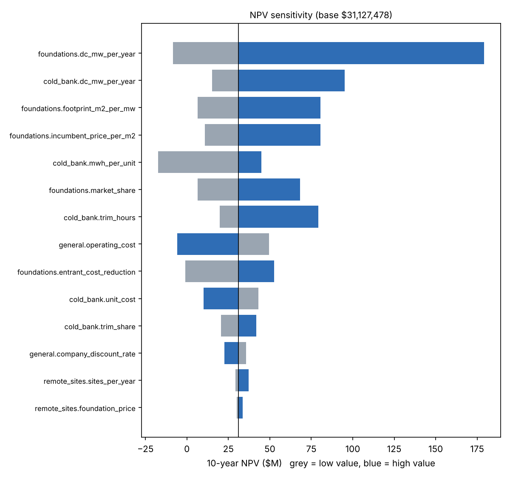

# Thermosiphon platform TEA: results

Inputs: `inputs/thermosiphon_base.toml`

## Headline

| Metric | Value |
|---|---|
| NPV over 10 years | $31,127,478 |
| Revenue at full ramp (year 5) | $36,676,000 |
| EBIT at full ramp (year 5) | $9,235,200 |
| Share of year-5 revenue: data center foundations | 69.5% |
| Share of year-5 revenue: cold bank | 24.5% |
| Share of year-5 revenue: remote sites | 3.2% |
| Share of year-5 revenue: glacier grants | 2.7% |
| Entrant foundation gross margin | 43.5% |
| Foundation cost as share of data center build cost | 2.7% |
| Customer saving, cold bank vs chiller | 12.4% |
| Arctic data center MW/yr needed for $1B/yr revenue (buying both A and B) | 1,802 |

## Cash flow

| Year | Ramp | Revenue | Gross profit | Operating cost | EBIT | Present value |
|---|---|---|---|---|---|---|
| 1 | 10% | $4,553,200 | $1,513,440 | $6,000,000 | -$4,486,560 | -$4,078,691 |
| 2 | 30% | $11,666,800 | $4,545,360 | $6,000,000 | -$1,454,640 | -$1,202,182 |
| 3 | 60% | $22,348,000 | $9,100,800 | $6,000,000 | $3,100,800 | $2,329,677 |
| 4 | 100% | $36,604,000 | $15,184,800 | $6,000,000 | $9,184,800 | $6,273,342 |
| 5 | 100% | $36,676,000 | $15,235,200 | $6,000,000 | $9,235,200 | $5,734,333 |
| 6 | 100% | $36,748,000 | $15,285,600 | $6,000,000 | $9,285,600 | $5,241,479 |
| 7 | 100% | $36,820,000 | $15,336,000 | $6,000,000 | $9,336,000 | $4,790,844 |
| 8 | 100% | $36,892,000 | $15,386,400 | $6,000,000 | $9,386,400 | $4,378,825 |
| 9 | 100% | $36,964,000 | $15,436,800 | $6,000,000 | $9,436,800 | $4,002,124 |
| 10 | 100% | $37,036,000 | $15,487,200 | $6,000,000 | $9,487,200 | $3,657,726 |

## Cooling cost to the customer ($/MWh of cold)

| Trim hours/yr | Chiller | Cold bank (our price) | Cold bank (our cost) | Cheaper |
|---|---|---|---|---|
| 300 | $286 | $89 | $53 | cold bank |
| 500 | $180 | $89 | $53 | cold bank |
| 1,000 | $101 | $89 | $53 | cold bank |
| 2,000 | $62 | $89 | $53 | chiller |
| 4,000 | $42 | $89 | $53 | chiller |

## Sensitivity (one input at a time, others at base)

| Input | Low | NPV at low | High | NPV at high |
|---|---|---|---|---|
| `foundations.dc_mw_per_year` | 50 | -$8,364,963 | 1,000 | $179,224,132 |
| `cold_bank.dc_mw_per_year` | 0 | $15,117,029 | 500 | $95,169,274 |
| `foundations.footprint_m2_per_mw` | 500 | $6,444,702 | 2,000 | $80,493,029 |
| `foundations.incumbent_price_per_m2` | 177 | $10,887,602 | 600 | $80,493,029 |
| `cold_bank.mwh_per_unit` | 3.31 | -$17,411,754 | 23.19 | $44,787,104 |
| `foundations.market_share` | 0.2 | $6,444,702 | 0.7 | $68,151,641 |
| `cold_bank.trim_hours` | 300 | $19,920,163 | 4,000 | $79,158,825 |
| `general.operating_cost` | 3,000,000 | $49,561,179 | 12,000,000 | -$5,739,925 |
| `foundations.entrant_cost_reduction` | 0.1 | -$893,421 | 0.6 | $52,474,743 |
| `cold_bank.unit_cost` | 4,000 | $43,135,315 | 15,000 | $10,113,763 |
| `cold_bank.trim_share` | 0.1 | $20,453,845 | 0.5 | $41,801,110 |
| `general.company_discount_rate` | 0.08 | $35,581,906 | 0.15 | $22,500,737 |
| `remote_sites.sites_per_year` | 20 | $29,381,558 | 200 | $37,238,197 |
| `remote_sites.foundation_price` | 15,000 | $30,060,114 | 100,000 | $33,689,150 |
| `general.customer_discount_rate` | 0.06 | $31,127,478 | 0.1 | $31,127,478 |
| `cold_bank.chiller_cop` | 3.0 | $31,127,478 | 6.0 | $31,127,478 |
| `cold_bank.electricity_price` | 60 | $31,127,478 | 150 | $31,127,478 |
| `cold_bank.generation_capex` | 1,000 | $31,127,478 | 2,500 | $31,127,478 |
| `glacier.grants` | 0 | $31,127,478 | 4,000,000 | $31,127,478 |

