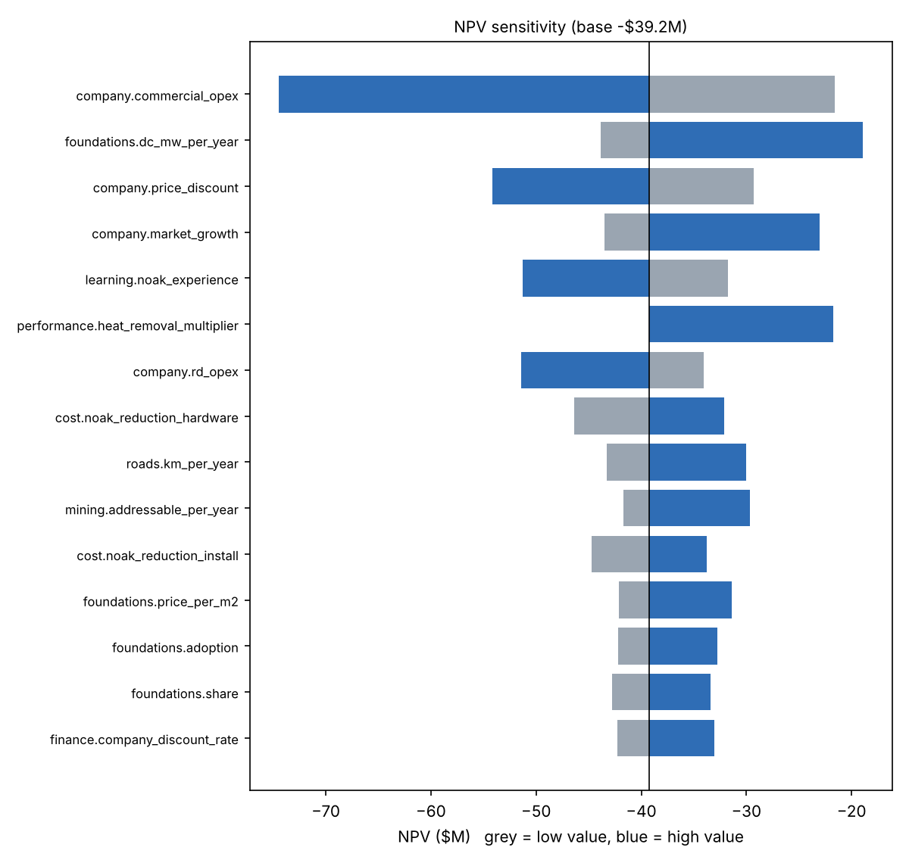
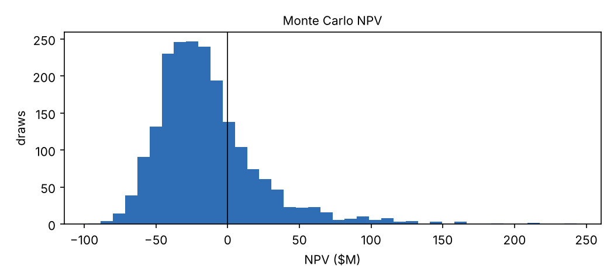

# Thermosyphon platform (Project Cryo): TEA results

## Conventions

- Real 2026 US dollars (pre-tax). Canadian figures converted at the fx rate below.
- Unit costs are entered at NOAK (Nth of a kind). The cost of getting there is shown separately with Wright's-law learning curves.
- **Boundary:** Supply, install, monitor and maintain thermosyphon systems. Excludes the customer's building, pad or road itself.
- **Functional units:** Foundations: $ per m2 protected per year. Roads: $ per km protected per year.
- Company discount rate 10%, customer discount rate 8%, horizon 15 years.

## Headline

| Metric | Value |
|---|---|
| NPV | -$39.2M |
| IRR | -36% |
| Probability NPV > 0 (Monte Carlo) | 25% |
| Peak cash need | $60.7M |
| Cash breakeven year | not within horizon |
| Revenue in final year | $28.9M |
| NOAK reached in year | not within horizon |
| Extra cost paid while learning (FOAK to NOAK) | $24.5M |
| NPV if costs started at NOAK (no learning period) | -$27.1M |

## Customer cost vs BAU

**Permafrost foundation** ($/m2 protected per yr)

| Option | Value | vs ours |
|---|---|---|
| Entrant at NOAK price | $26 | 1.00x |
| Incumbent thermosyphons | $33 | 1.23x |
| Entrant if priced at NOAK cost | $19 | 0.72x |

Alternatives such as gravel pads or piles can't be priced per m2 from public data, so BAU here is the incumbent thermosyphon system.

**Road or runway on warm permafrost** ($/km protected per yr)

| Option | Value | vs ours |
|---|---|---|
| Entrant at NOAK price | $376,164 | 1.00x |
| Repair as it settles | $22,000 | 0.06x |
| Air-convection embankment | $70,344 | 0.19x |
| Incumbent thermosyphons | $462,575 | 1.23x |
| Entrant if priced at NOAK cost | $270,634 | 0.72x |

Thermosyphons are only chosen where repair or air-convection can't hold the road (warm, ice-rich permafrost).

## FOAK to NOAK

Cost multiplier vs the incumbent's cost for each component (1.00 = incumbent).

| Component | FOAK | NOAK |
|---|---|---|
| hardware | 1.57 | 0.60 |
| install | 1.15 | 0.85 |
| logistics | 0.90 | 0.90 |
| engineering | 1.30 | 0.70 |

## Cash flow

| Year | Phase | Revenue | Gross profit | Operating cost | EBIT | Capex | Cumulative cash | Cost vs incumbent |
|---|---|---|---|---|---|---|---|---|
| 1 | R&D | $200,000 | $0 | $8.0M | -$8.0M | $0 | -$8.0M | 1.26 |
| 2 | R&D | $200,000 | $0 | $8.0M | -$8.0M | $0 | -$16.0M | 1.26 |
| 3 | commercial | $1.6M | -$269,257 | $6.0M | -$6.3M | $254,250 | -$22.6M | 1.26 |
| 4 | commercial | $4.8M | -$626,860 | $6.1M | -$6.8M | $546,638 | -$29.9M | 1.21 |
| 5 | commercial | $9.8M | -$474,969 | $6.3M | -$6.8M | $880,976 | -$37.5M | 1.12 |
| 6 | commercial | $17.1M | $641,482 | $6.5M | -$5.9M | $1.3M | -$44.7M | 1.03 |
| 7 | commercial | $18.2M | $2.0M | $6.5M | -$4.5M | $147,163 | -$49.3M | 0.95 |
| 8 | commercial | $19.3M | $3.0M | $6.6M | -$3.6M | $154,521 | -$53.0M | 0.91 |
| 9 | commercial | $20.5M | $3.8M | $6.6M | -$2.8M | $162,247 | -$56.0M | 0.88 |
| 10 | commercial | $21.7M | $4.6M | $6.7M | -$2.0M | $170,360 | -$58.2M | 0.85 |
| 11 | commercial | $23.0M | $5.3M | $6.7M | -$1.3M | $178,878 | -$59.7M | 0.83 |
| 12 | commercial | $24.4M | $6.1M | $6.7M | -$661,418 | $187,822 | -$60.6M | 0.82 |
| 13 | commercial | $25.8M | $6.8M | $6.8M | $26,261 | $197,213 | -$60.7M | 0.80 |
| 14 | commercial | $27.3M | $7.5M | $6.8M | $725,398 | $207,073 | -$60.2M | 0.79 |
| 15 | commercial | $28.9M | $8.3M | $6.9M | $1.4M | $217,427 | -$59.0M | 0.78 |

Revenue in the final year by stream:

- foundations: $11.0M (38%)
- remote: $1.5M (5%)
- roads: $7.7M (27%)
- mining: $5.7M (20%)
- monitoring: $1.4M (5%)
- maintenance: $1.4M (5%)
- glacier_grants: $200,000 (1%)

## Break-evens

| Question | Answer | Base input |
|---|---|---|
| Arctic data center MW/yr for NPV = 0 | 1,662 | 250 |
| Price discount at which NPV = 0 | no crossing in range | 0.15 |
| Mining freeze-work $/yr for NPV = 0 | 150,553,007 | 15,000,000 |
| Incumbent road cost per km at which our NOAK cost equals repairing as it settles | 261,378 | 4,200,000 |

## Sensitivity (one input at a time)

| Input | Low | NPV at low | High | NPV at high |
|---|---|---|---|---|
| `company.commercial_opex` | 3,000,000 | -$21.6M | 12,000,000 | -$74.5M |
| `foundations.dc_mw_per_year` | 50 | -$43.8M | 1,000 | -$18.9M |
| `company.price_discount` | 0.05 | -$29.3M | 0.3 | -$54.2M |
| `company.market_growth` | 0.0 | -$43.5M | 0.15 | -$23.1M |
| `learning.noak_experience` | 100,000,000 | -$31.8M | 1,000,000,000 | -$51.3M |
| `performance.heat_removal_multiplier` | 1.0 | -$39.2M | 1.5 | -$21.7M |
| `company.rd_opex` | 5,000,000 | -$34.0M | 15,000,000 | -$51.4M |
| `cost.noak_reduction_hardware` | 0.2 | -$46.4M | 0.6 | -$32.1M |
| `roads.km_per_year` | 0.5 | -$43.3M | 8 | -$30.0M |
| `mining.addressable_per_year` | 5,000,000 | -$41.7M | 50,000,000 | -$29.6M |
| `cost.noak_reduction_install` | 0.0 | -$44.7M | 0.3 | -$33.7M |
| `foundations.price_per_m2` | 177 | -$42.2M | 600 | -$31.4M |
| `foundations.adoption` | 0.2 | -$42.2M | 0.8 | -$32.7M |
| `foundations.share` | 0.2 | -$42.8M | 0.7 | -$33.4M |
| `finance.company_discount_rate` | 0.08 | -$42.3M | 0.15 | -$33.0M |

## Monte Carlo

2,000 draws, triangular distribution on every input with a range.

| P10 | P50 | P90 | P(NPV > 0) |
|---|---|---|---|
| -$50.8M | -$20.8M | $28.3M | 25% |

## Kill metrics

| Metric | Value | Threshold | Passes |
|---|---|---|---|
| NOAK installed-cost reduction vs incumbent | 0.24 fraction | 0.30 | no |
| 10x test: incumbent life-cycle cost / ours at NOAK cost (foundations) | 1.72 x | 10.00 | no |
| Roads: our NOAK cost vs repairing as it settles | 12.30 x (<=1 to win) | 1.00 | no |
| Revenue at full scale vs big-enough line | 0.03 x | 1.00 | no |
| Probability NPV > 0 | 25% | 50% | no |

## Scorecard

Economics is scored from P(NPV > 0); the rest are judgment scores set in the inputs file.

| Category | Weight | Score |
|---|---|---|
| impact | 20% | 3 |
| breakthrough | 20% | 3 |
| feasibility | 15% | 4 |
| economics | 15% | 2 |
| scalability | 10% | 2 |
| demand | 10% | 3 |
| white space | 5% | 4 |
| validation | 5% | 4 |
| **Weighted total** | | **3.00** |

## Notes

- Cash flow is operating profit less capex: pre-tax, no working capital.
- NPV includes remaining-life cash from the installed base (services only, no new sales) while it stays positive; 0 tail years counted. NPV over the 15-yr horizon alone: $-39.2M.
- Customer price is value-based (incumbent price less a discount), so our cost cuts become margin, not lower customer cost.

